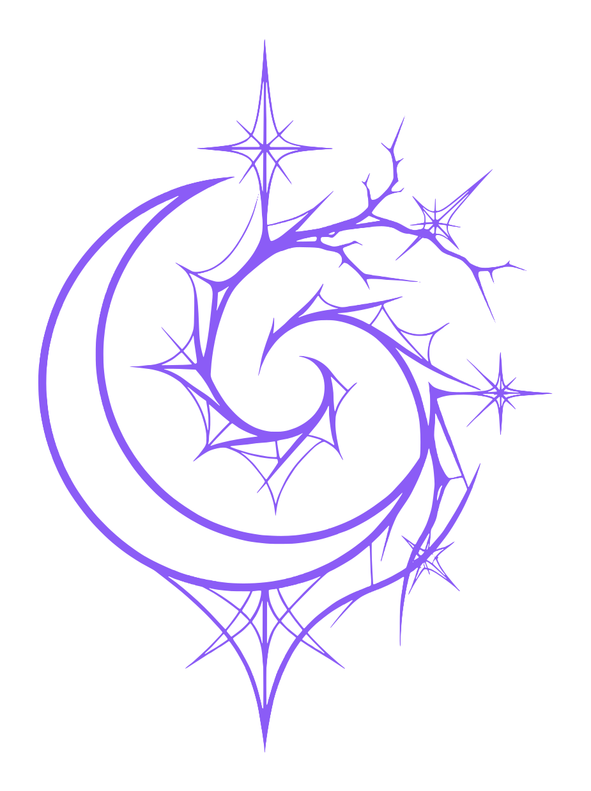
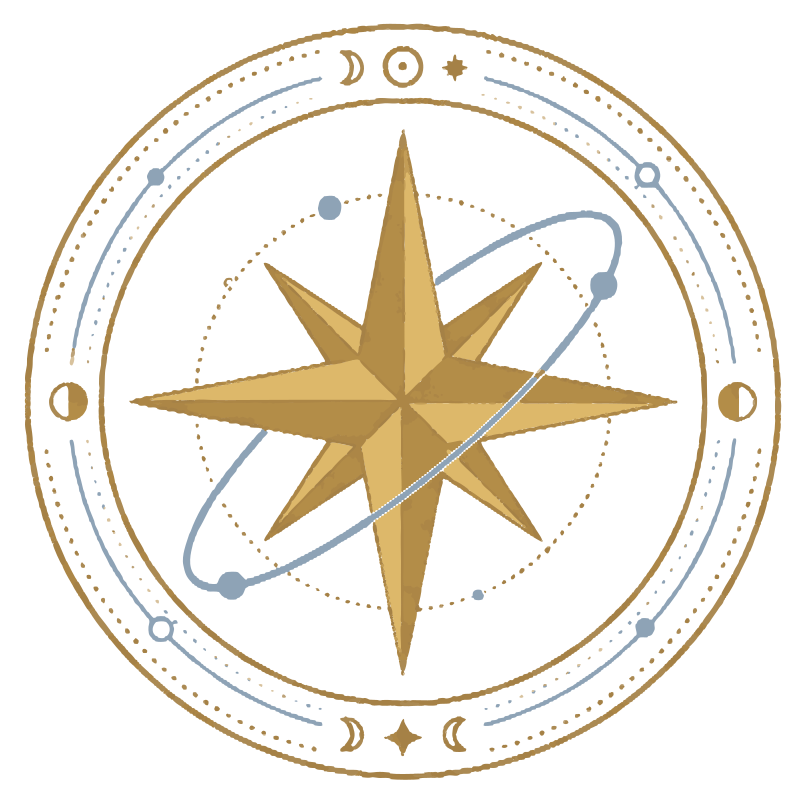

<div align="center">
<h1>Chaos / Deva</h1>
<p><strong>Portfólio estático (GitHub Pages) em duas identidades: CHAOS e DEVA.</strong></p>
<p><strong>Um ecossistema digital moderno combinando estética, interatividade e inovação.</strong></p>
</div>

<div align="center">
  
  
  
</div>

<br>

---

## 📋 Sobre o Projeto

O **Chaos / Deva** é um projeto de portfólio web, moderno estruturado com uma arquitetura limpa e organizada. Utilizando tecnologias web padrão (`HTML5`, `CSS3` e `JavaScript Vanilla`), a aplicação oferece uma experiência visual imersiva com ativos customizados (logos, símbolos, wordmarks e ícones de alta resolução).

🔗 **Acesse a página do projeto:** [https://jvitoraraujo.github.io/chaosdeva/](https://jvitoraraujo.github.io/chaosdeva/)

---

## 🗂️ Estrutura do Repositório

Abaixo está a organização dos principais diretórios e arquivos que compõem o repositório:

```text
chaosdeva/
├── 404.html               # Página de erro personalizada
├── index.html             # Página principal da aplicação
├── .nojekyll              # Configuração para deploy no GitHub Pages
├── README.md              # Documentação do projeto
├── assets/                # Recursos visuais e gráficos
│   ├── chaos-logo.svg
│   ├── chaos-simbolo.svg
│   ├── chaos-wordmark.svg
│   ├── deva-sigilo.svg
│   ├── deva-simbolo.svg
│   ├── deva-wordmark.svg
│   └── icons/             # Favicons e ícones (de 16px a 1024px)
├── LICENSE                # Direitos reservados
├── css/
│   └── style.css          # Estilos globais e customizados
└── js/
    ├── app.js             # Lógica principal de execução
    └── content.js         # Gerenciamento de conteúdo e dados dinâmicos
```

---

## 🚀 Tecnologias Utilizadas

* **HTML5:** Marcação semântica e estruturação da página.
* **CSS3:** Estilização responsiva e efeitos visuais modernos.
* **JavaScript (ES6+):** Manipulação de estado, interatividade e carregamento de conteúdo dinâmico (`app.js` e `content.js`).
* **SVG:** Vetores escaláveis de alta qualidade para logotipos e símbolos.

---

## 📄 Licença

© CHAOS / DEVA - 2026. Todos os direitos reservados.

O código, os textos e as identidades visuais (logos, símbolos, wordmarks e ícones) deste repositório não podem ser copiados, modificados ou redistribuídos sem autorização expressa do autor. Veja o arquivo [`LICENSE`](LICENSE).

---

<div align="center">
  <p>✦ . * Feito com dedicação para os universos Chaos & Deva * . ✦</p>
</div>
